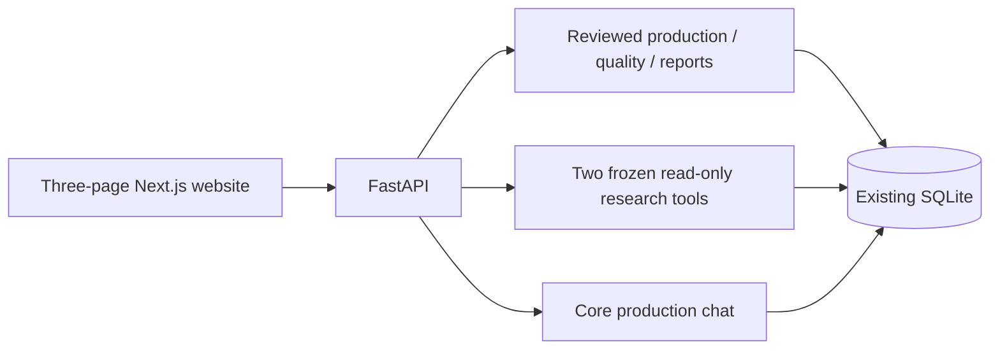

# Core production website architecture

The active Next.js application exposes three routes: `/dashboard`, `/production`
(including machine detail pages), and `/ai-expert`. Shared workspace filters and
URL persistence are reused across all three.



## Active responsibilities

- `frontend/components/workspace.tsx`: three-item navigation, filters, theme,
  refresh/data state and URL persistence; no placeholder notifications or avatar.
- `frontend/components/screens/`: only Dashboard, Production and AI screens are
  imported by the active screen router. Four historical screen modules are
  retained but have no public Next.js page route.
- `frontend/components/research-analysis.tsx`: input comparison and recorded
  abnormality ranking, chart/table views, strict scope matching and folded coverage.
- `frontend/components/charts/input-trend.tsx` and `frontend/lib/trend-layout.ts`:
  all-value labels, calendar geometry, connected observations and changeover marks.
- `frontend/components/production-entry.tsx`: reviewed manual input using existing
  duplicate/conflict protections; optional entry guidance stays folded.
- `frontend/components/quality-analysis.tsx`: precise area summaries, charts and
  paged detail records without inventing missing production.
- `backend/research.py`: typed `GET /api/research/analysis`, a single snapshot for
  both tools and zero model calls. Unsupported product/extra filters are rejected.
- `backend/agent.py`: the website passes `core_only=True`; only production and
  recorded-abnormality tools are exposed. Removed topics return clarification
  before any model request. Explicit date ranges retain both endpoints.
- `backend/data.py`, `runtime.py`, `production_entry.py`, `quality.py`, `reports.py`:
  existing shared calculations, assumption-labelled runtime estimates, reviewed
  entry, independent quality reads and PDF/HTML reports.

Calculations and units remain in Python. The browser never recomputes business
metrics, creates missing rows, infers roots of lost production or changes SQLite
through an AI tool. Runtime estimates and raw event-minute totals remain distinct.

## Retained compatibility code

Planning calculators, inventory/knowledge endpoints, document-indexing modules,
legacy screen source, Streamlit and optional MCP adapters are preserved for
historical/offline compatibility. They are not current website pages or tools of
its chat. This cleanup does not delete business databases, private documents or
existing numeric backups. The root Flask application remains independent.

## Setup and local services

Use Python 3.12 and Node 24. From the application directory:

```bash
python3.12 -m venv backend/.venv
backend/.venv/bin/python -m pip install -r backend/requirements.txt
cd frontend
npm ci
cd ..
```

Then start `bash scripts/start_backend.sh` and `bash scripts/start_frontend.sh`
in separate terminals. The API binds to 127.0.0.1:8000, and the website to
127.0.0.1:3000. A production-mode frontend uses `npm run build` and `npm run start`.
The environment and installed dependencies are reused; no package installation
or removal was required for this core-interface change.

Optional model credentials belong in the private backend environment. The
frontend's **AI options** disclosure retains the explicit model toggle and
transmission consent. Model tool selection stops after one local result; it does
not send a follow-up production payload for synthesis. Tracing/storage are off.
The independent research benchmark uses its own explicit paid-run gate; live
model evaluation has not been executed.

The application remains localhost-only. Origin, Host and local-client header
checks do not constitute authenticated multi-user hosting. No credentials or
company data are included in the published source.

## Validation

- 176 enterprise/research pytest cases passed, including new core-topic/tool
  restrictions and exact question date-range boundaries.
- 61 existing production/dashboard/abnormality/recovery/diagnostics/data tests and
  14 trend-layout tests passed: **251 total**.
- TypeScript, the production build, Ruff F and whitespace checks passed.
- Final HTTP checks cover the three active pages, 404s for retired pages, reviewed
  filters/research data, production entry schema and report availability.
- Frozen research version 1.1 and pre-existing database/numeric-file hashes stay
  unchanged.

HTTP/source/build checks do not establish browser pixel/layout acceptance. No
browser visual check or paid model-quality experiment is claimed. See the
[application guide](../README.md), [research guide](../research/harry_milestone/README.md)
and [frozen research results](../research/harry_milestone/RESULTS.md).
