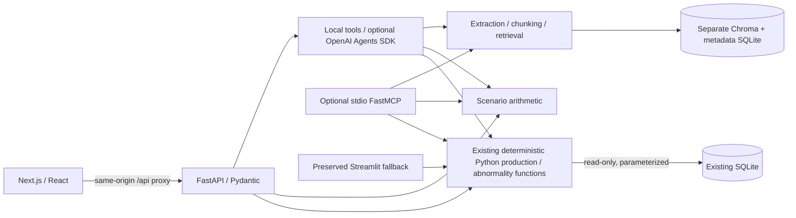

# Manufacturing Operations Web - incremental first release

This local development release adds a Next.js UI and FastAPI facade to the
existing Production Data Viewer Agent. It does not replace Streamlit, migrate
production tables, deploy a SaaS service or connect live equipment.

## Architecture



The browser renders charts and sends typed requests. Python owns calculations;
TypeScript never recreates production math. `backend/data.py` adapts the existing
`ai_production_data`, `production_dashboard`, and `abnormality` modules. It opens
production SQLite read-only, and never reads the fake seed orders/inventory as
real operations. Direct parameterized product discovery is static SQL. The AI
has no generated-SQL executor, arbitrary database tool or write tool.

- `frontend/components/workspace.tsx`: persistent navigation, URL filters, theme,
  source separation, loading/error states, in-memory chat history.
- `frontend/components/screens/`: seven independent page components.
- `frontend/components/ui/`: shadcn/ui components generated with its CLI.
- `frontend/lib/api.ts`: typed client; keys never enter client code.
- `backend/models.py`: Pydantic request/response contracts and bounded inputs.
- `backend/main.py`: endpoints, validation, local CORS/host/client boundaries.
- `backend/calculations.py`: capacity, forecast and scenario comparison.
- `backend/agent.py`: explicit local intent routing and one optional Agents SDK.
- `backend/knowledge.py`: extraction, index metadata, vectors and source locations.
- `backend/reports.py`: reuse of existing ReportLab layout/calculations.
- `backend/mcp_server.py`: optional stdio tools using the same Python functions.
- `tests/enterprise/`: isolated synthetic API/tool/index tests.

A new SQLAlchemy model layer is not needed for read-only adapters to established
tables. Future transactional ERP/MES work should introduce reviewed schemas,
authentication and migrations before enabling writes.

## Prerequisites and setup

Use Python **3.12** for the independent new backend environment and Node **24**
for the frontend. The checked local runtime uses Python 3.12.14 and Node 24.14.1.
The old Streamlit `.venv` is separate and remains unchanged. All commands below
start at the repository root, not the parent project folder.

macOS:

```bash
python3.12 -m venv backend/.venv
backend/.venv/bin/python -m pip install -r backend/requirements.txt
cd frontend
npm ci
cd ..
```

Windows PowerShell:

```powershell
py -3.12 -m venv backend/.venv
backend/.venv/Scripts/python.exe -m pip install -r backend/requirements.txt
Set-Location frontend
npm.cmd ci
Set-Location ..
```

Windows instructions are provided, but were not executed on a Windows machine.
The frozen backend requirements exclude `uvloop` on Windows. No activation or
system execution-policy changes are required when using the direct commands.

## Start two processes

macOS, terminal 1:

```bash
bash scripts/start_backend.sh
```

macOS, terminal 2:

```bash
bash scripts/start_frontend.sh
```

Windows terminal 1 (direct command, no activation needed):

```powershell
backend/.venv/Scripts/python.exe -m uvicorn backend.main:app --host 127.0.0.1 --port 8000 --no-access-log
```

Windows terminal 2:

```powershell
Set-Location frontend
npm.cmd run dev
```

PowerShell wrappers are also available under `scripts/`. For a production-mode
local preview, run `npm run build` then `npm run start` inside `frontend/`.

- New UI: <http://127.0.0.1:3000/dashboard>
- API documentation: <http://127.0.0.1:8000/docs>
- Preserved Streamlit UI: <http://127.0.0.1:8502/>

Start Streamlit independently with the original environment:

```bash
.venv/bin/python -B -m streamlit run streamlit_app.py --server.address 127.0.0.1 --server.port 8502
```

Both new services bind to loopback. This is not a network deployment. Account and
notification controls are explicitly placeholders; authentication/RBAC are not
implemented. Do not expose the development API on a public or company network.

## Configuration and consent

Nothing is required for local production views, Python scenarios, or default
knowledge retrieval. Optional configuration lives in `backend/.env`; copy
`backend/.env.example` and fill it privately. The repository-root `.env` is not
loaded by this backend. It does not copy or read Streamlit secrets.

| Variable | Meaning |
| --- | --- |
| `PRODUCTION_DB` | Existing SQLite path; default repository `manufacturing.db` |
| `KNOWLEDGE_DIR` | Separate persistent extracted-text/vector directory |
| `LLM_API_KEY` or `OPENAI_API_KEY` | Optional server-only key |
| `LLM_BASE_URL`, `LLM_MODEL` | Optional compatible Responses provider/model |
| `EMBEDDING_PROVIDER` | `local-hash-v1` by default; optional `openai` |
| `EMBEDDING_MODEL` | Optional semantic embedding model; default `text-embedding-3-small` |
| `ALLOWED_ORIGINS` | Explicit localhost frontend allowlist |

The UI shows configuration **presence**, never key values. No `NEXT_PUBLIC` key
is used. `frontend/.env.example` documents only the server-side proxy target.

Optional LLM calls require an explicit UI checkbox. The SDK selects one bounded
read-only tool and stops after that tool. Production/document tool outputs stay
local; tracing is disabled and model storage is disabled. This release does
**not** send retrieved company text to an LLM for a second synthesis call.
Capacity tool arguments must match explicit user inputs; complex assumptions use
the Planning form. Missing credentials fall back to local tools. No paid model
request was used to validate this release; SDK requests were mocked.

## Knowledge retrieval

Upload text-based PDF, DOCX, UTF-8 TXT or Markdown (up to 5 MiB, 250,000 extracted
characters; PDFs at most 200 pages; DOCX expansion at most 20 MiB; at most 400
chunks). Image-only files are rejected: no OCR was added. Seven document
categories, deduplication, source locations and same-model reindexing are
supported. Extracted text is stored locally; raw uploaded files are not retained.

The default vectorizer is a deterministic **lexical hash**, not a learned
semantic embedding. It works without keys, network/model downloads or model
weights. Chroma stores these vectors, and a lexical relevance guard prevents
unrelated matches. This is a working local retrieval baseline, with limited
paraphrase/cross-language recall. Answers quote matching evidence with document
and page/paragraph citations; they explicitly identify extractive responses.

Optional `EMBEDDING_PROVIDER=openai` enables learned semantic embeddings. Upload,
reindex and question text require explicit permission before transmission and
may incur charges. Changing embedding model/provider requires a separate
`KNOWLEDGE_DIR`; incompatible vector spaces are never mixed. Offline tests cover
permission gates, not the quality of a paid embedding model. Grounded LLM
interpretation, revision approval workflows, OCR and retrieval evaluations are
future work, not claimed as completed.

Try the synthetic `sample_data/sample-sop.md` (also downloadable in Knowledge
Base). It is not a factory procedure. Ask: "What cleaning evidence does the SOP
require?" Uploaded content is evidence, never an instruction source for tools.

## Input trend readability

The planned/actual input trend occupies a full row, separate from the overview
cards. Actual input uses a blue solid line and filled points; the plan uses a
slate dashed line and hollow points. Equal values use concentric points. Value
labels follow their own points: the higher series is above and the lower below;
for equal values, plan is above and actual below. Colours adapt to dark mode.

Every non-null actual and planned input value is labeled, including explicit
zero. Weekly views use Actual/Plan prefixes; longer ranges use compact numbers
in the corresponding series colour, with the fixed legend and mother-roll unit.
Tooltips retain both exact counts and the full date. No recorded value is sampled
away to reduce label density.
Confirmed changeover lines and rings stay visible for the selected machine;
short text uses a separate event band with collision lanes. Multiple same-day
events keep both descriptions. Detailed explanations remain collapsed by default.
Date ticks are horizontal MM-DD within the selected calendar bounds. The input
chart uses UTC calendar anchors so timezone/DST changes do not shift business dates.

The plot reserves headroom, a date-label area and edge space. Narrow layouts
scroll the plot horizontally instead of compressing labels. Minimum canvas width
uses the selected calendar span, observed date gaps and label widths so all value
labels have room. Missing days remain absent and recorded points connect across
gaps with true calendar spacing. Production math and database records are unchanged.

Below the input chart, the first/last recorded dates and missing-date count refer
only to the current filters. The full date/actual/plan table and missing-date list
are collapsed native disclosures. The bottom Machine performance records table
also starts collapsed; expanding it reveals the existing rows and all nine columns,
including unavailable values. This does not hide chart points or remove records.

Run the dependency-free layout checks from `frontend/` with Node 24:

```bash
node --test tests/trend-layout.test.mjs
```

Validation for this input-trend update: 14 layout tests, 13 existing
dashboard/production regressions, TypeScript and production build checks passed.
Controlled server-rendering checks covered complete non-null labels, point-table
rows and default-collapsed disclosure markup with original columns and unavailable
values preserved. Local data-file hashes remained unchanged. Production data and
private validation examples are not included in this repository.
Browser pixel/layout and mouse/keyboard interaction acceptance was not performed;
controlled server rendering, numerical layout checks and HTTP success do not
establish browser visual acceptance. No dependency or backend changes were needed.

## Metrics and missing data

Reviewed history is the default. A separate synthetic source uses fabricated
records; inventory is always a labeled synthetic example. FX1-FX7 are selectable;
actual historical FX8 is retained. Unobserved machines are not assigned a live
state. Recorded machines are not operating machines or utilization.

- Attainment = summed input mother rolls / summed planned mother rolls.
- Area qualification = summed qualified area / summed actual area.
- No denominator -> unavailable. No records -> unavailable, not zero.
- Qualified finished rolls and input mother rolls are different units.
- Reported yield is retained, never inferred or aggregated as an unknown ratio.
- Abnormality event-minutes are reported sums, not deduplicated net downtime,
  OEE, lost production time or demonstrated production-loss causes.
- Event aggregates are independent of production and have no product attribution.
  Product-filtered views explicitly disclose that difference.
- Recorded trend points connect across missing dates, keeping calendar spacing.
  No missing points/zeros are fabricated. One selected machine shows confirmed
  changeover lines; explanations are collapsed by default.
- Measured CT, available runtime, utilization and real capacity remain unavailable.

Capacity uses **per-machine** available minutes A, downtime D, CT in minutes C,
machine count N, units per cycle U, stated yield Y:

```text
theoretical cycles = floor(A / C) * N
estimated cycles = floor((A - D) / C) * N
qualified scenario output = estimated cycles * U * Y
output difference from no downtime = theoretical cycles * U * Y - output
scenario capacity fraction = estimated cycles / theoretical cycles
```

The last ratio is a scenario reference, not measured equipment utilization.
Partial cycles cannot pool across machines. All scenario machines are identical
virtual resources; no actual FX allocation, completion date or optimal schedule
is promised. Example: 2 machines, 480 minutes each, CT=27 minutes -> 34 completed
cycles with no downtime and yield=1. Planning permits explicit downtime, yield
and output-unit assumptions. Inventory illustrates one synthetic BOM and
finished-roll-equivalent coverage, not real stock or coverage days.

## Validation

```bash
backend/.venv/bin/python -m pytest tests/enterprise -q
backend/.venv/bin/python -m pip check
cd frontend
npm run typecheck
npm run build
```

The original 12-module, 109-test suite continues to run with the original `.venv`.
New tests use temporary databases/knowledge directories and do not overwrite
production data. Coverage includes calculations, zero/missing data, input and
origin restrictions, document extraction, citations/reindexing, consent, mocked
SDK calls, optional FastMCP, independent event analysis and report downloads.

Tests, build checks and HTTP checks do not constitute pixel-level browser visual
acceptance. The current session cannot complete browser visual verification;
layout/interaction acceptance remains open. No real model quality or Windows
runtime acceptance is claimed.

Validated locally on 2026-10-24: 37 new tests and 109 preserved tests passed;
378 actual date/window/shift/machine combinations matched the old metrics;
46 pre-existing production/database/source files retained their hashes.
All seven pages plus FX8 details returned HTTP 200, unknown sections returned
404, and the same-origin proxy successfully handled production, scenario chat,
synthetic SOP upload/citation, and PDF/HTML download. The MCP stdio handshake,
tool listing and capacity call were exercised (32 cycles). The synthetic PDF
was rendered and visually reviewed across its three pages. This PDF check does
not imply browser layout acceptance. Service/API checks and build/type checks
passed; no paid model request or deployment was performed.

## Next development phase

1. Review the new local UI with users at desktop widths and measure usability.
2. Establish a small reviewed SOP question/citation evaluation set, then validate
   optional semantic embeddings and separately authorized grounded generation.
3. Collect actual runtime, product-specific cycle standards, order allocations
   and stock/BOM records before enabling operational capacity or completion dates.
4. Add authentication/RBAC, audit logging, retention/backup controls and production
   deployment architecture before any shared SaaS release.
