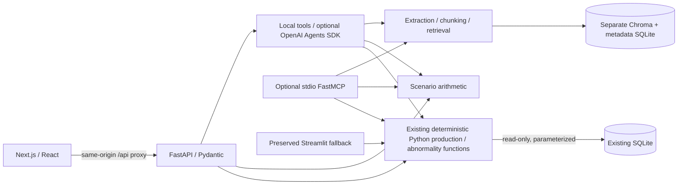

# Manufacturing Operations Web - incremental first release

This local development release adds a Next.js UI and FastAPI facade to the
existing Production Data Viewer Agent. It does not replace Streamlit, migrate
production tables, deploy a SaaS service or connect live equipment.

## Architecture



The browser renders charts and sends typed requests. Python owns calculations;
TypeScript never recreates production math. `backend/data.py` adapts the existing
`ai_production_data`, `production_dashboard`, and `abnormality` modules. It opens
production SQLite read-only, and never reads the fake seed orders/inventory as
real operations. Direct parameterized product discovery is static SQL. The AI
has no generated-SQL executor, arbitrary database tool or write tool.

- `frontend/components/workspace.tsx`: persistent navigation, URL filters, theme,
  source separation, loading/error states, in-memory chat history.
- `frontend/components/screens/`: seven independent page components.
- `frontend/components/ui/`: shadcn/ui components generated with its CLI.
- `frontend/lib/api.ts`: typed client; keys never enter client code.
- `backend/models.py`: Pydantic request/response contracts and bounded inputs.
- `backend/main.py`: endpoints, validation, local CORS/host/client boundaries.
- `backend/calculations.py`: capacity, forecast and scenario comparison.
- `backend/runtime.py`: read-only time inputs, per-machine interval unions and
  flexible-break runtime/utilization ranges with explicit record coverage.
- `backend/agent.py`: explicit local intent routing and one optional Agents SDK.
- `backend/knowledge.py`: extraction, index metadata, vectors and source locations.
- `backend/reports.py`: reuse of existing ReportLab layout/calculations.
- `backend/mcp_server.py`: optional stdio tools using the same Python functions.
- `tests/enterprise/`: isolated synthetic API/tool/index tests.

A new SQLAlchemy model layer is not needed for read-only adapters to established
tables. Future transactional ERP/MES work should introduce reviewed schemas,
authentication and migrations before enabling writes.

## Prerequisites and setup

Use Python **3.12** for the independent new backend environment and Node **24**
for the frontend. The checked local runtime uses Python 3.12.14 and Node 24.14.1.
The old Streamlit `.venv` is separate and remains unchanged. All commands below
start at the repository root, not the parent project folder.

macOS:

```bash
python3.12 -m venv backend/.venv
backend/.venv/bin/python -m pip install -r backend/requirements.txt
cd frontend
npm ci
cd ..
```

Windows PowerShell:

```powershell
py -3.12 -m venv backend/.venv
backend/.venv/Scripts/python.exe -m pip install -r backend/requirements.txt
Set-Location frontend
npm.cmd ci
Set-Location ..
```

Windows instructions are provided, but were not executed on a Windows machine.
The frozen backend requirements exclude `uvloop` on Windows. No activation or
system execution-policy changes are required when using the direct commands.

## Start two processes

macOS, terminal 1:

```bash
bash scripts/start_backend.sh
```

macOS, terminal 2:

```bash
bash scripts/start_frontend.sh
```

Windows terminal 1 (direct command, no activation needed):

```powershell
backend/.venv/Scripts/python.exe -m uvicorn backend.main:app --host 127.0.0.1 --port 8000 --no-access-log
```

Windows terminal 2:

```powershell
Set-Location frontend
npm.cmd run dev
```

PowerShell wrappers are also available under `scripts/`. For a production-mode
local preview, run `npm run build` then `npm run start` inside `frontend/`.

- New UI: <http://127.0.0.1:3000/dashboard>
- API documentation: <http://127.0.0.1:8000/docs>
- Preserved Streamlit UI: <http://127.0.0.1:8502/>

Start Streamlit independently with the original environment:

```bash
.venv/bin/python -B -m streamlit run streamlit_app.py --server.address 127.0.0.1 --server.port 8502
```

Both new services bind to loopback. This is not a network deployment. Account and
notification controls are explicitly placeholders; authentication/RBAC are not
implemented. Do not expose the development API on a public or company network.

## Configuration and consent

Nothing is required for local production views, Python scenarios, or default
knowledge retrieval. Optional configuration lives in `backend/.env`; copy
`backend/.env.example` and fill it privately. The repository-root `.env` is not
loaded by this backend. It does not copy or read Streamlit secrets.

| Variable | Meaning |
| --- | --- |
| `PRODUCTION_DB` | Existing SQLite path; default repository `manufacturing.db` |
| `KNOWLEDGE_DIR` | Separate persistent extracted-text/vector directory |
| `LLM_API_KEY` or `OPENAI_API_KEY` | Optional server-only key |
| `LLM_BASE_URL`, `LLM_MODEL` | Optional compatible Responses provider/model |
| `EMBEDDING_PROVIDER` | `local-hash-v1` by default; optional `openai` |
| `EMBEDDING_MODEL` | Optional semantic embedding model; default `text-embedding-3-small` |
| `ALLOWED_ORIGINS` | Explicit localhost frontend allowlist |

The UI shows configuration **presence**, never key values. No `NEXT_PUBLIC` key
is used. `frontend/.env.example` documents only the server-side proxy target.

Optional LLM calls require an explicit UI checkbox. The SDK selects one bounded
read-only tool and stops after that tool. Production/document tool outputs stay
local; tracing is disabled and model storage is disabled. This release does
**not** send retrieved company text to an LLM for a second synthesis call.
Capacity tool arguments must match explicit user inputs; complex assumptions use
the Planning form. Missing credentials fall back to local tools. No paid model
request was used to validate this release; SDK requests were mocked.

## Knowledge retrieval

Upload text-based PDF, DOCX, UTF-8 TXT or Markdown (up to 5 MiB, 250,000 extracted
characters; PDFs at most 200 pages; DOCX expansion at most 20 MiB; at most 400
chunks). Image-only files are rejected: no OCR was added. Seven document
categories, deduplication, source locations and same-model reindexing are
supported. Extracted text is stored locally; raw uploaded files are not retained.

The default vectorizer is a deterministic **lexical hash**, not a learned
semantic embedding. It works without keys, network/model downloads or model
weights. Chroma stores these vectors, and a lexical relevance guard prevents
unrelated matches. This is a working local retrieval baseline, with limited
paraphrase/cross-language recall. Answers quote matching evidence with document
and page/paragraph citations; they explicitly identify extractive responses.

Optional `EMBEDDING_PROVIDER=openai` enables learned semantic embeddings. Upload,
reindex and question text require explicit permission before transmission and
may incur charges. Changing embedding model/provider requires a separate
`KNOWLEDGE_DIR`; incompatible vector spaces are never mixed. Offline tests cover
permission gates, not the quality of a paid embedding model. Grounded LLM
interpretation, revision approval workflows, OCR and retrieval evaluations are
future work, not claimed as completed.

Try the synthetic `sample_data/sample-sop.md` (also downloadable in Knowledge
Base). It is not a factory procedure. Ask: "What cleaning evidence does the SOP
require?" Uploaded content is evidence, never an instruction source for tools.

## Input trend readability

The planned/actual input trend occupies a full row, separate from the overview
cards. Actual input uses a blue solid line and filled points; the plan uses a
slate dashed line and hollow points. Equal values use concentric points. Value
labels follow their own points: the higher series is above and the lower below;
for equal values, plan is above and actual below. Colours adapt to dark mode.

Every non-null actual and planned input value is labeled, including explicit
zero. Weekly views use Actual/Plan prefixes; longer ranges use compact numbers
in the corresponding series colour, with the fixed legend and mother-roll unit.
Tooltips retain both exact counts and the full date. No recorded value is sampled
away to reduce label density.
Confirmed changeover lines and rings stay visible for the selected machine;
short text uses a separate event band with collision lanes. Multiple same-day
events keep both descriptions. Detailed explanations remain collapsed by default.
Date ticks are horizontal MM-DD within the selected calendar bounds. The input
chart uses UTC calendar anchors so timezone/DST changes do not shift business dates.

The plot reserves headroom, a date-label area and edge space. Narrow layouts
scroll the plot horizontally instead of compressing labels. Minimum canvas width
uses the selected calendar span, observed date gaps and label widths so all value
labels have room. Missing days remain absent and recorded points connect across
gaps with true calendar spacing. Production math and database records are unchanged.

Below the input chart, the first/last recorded dates and missing-date count refer
only to the current filters. The full date/actual/plan table and missing-date list
are collapsed native disclosures. The bottom Machine performance records table
also starts collapsed; expanding it reveals the existing rows and all nine columns,
including unavailable values. This does not hide chart points or remove records.

Run the dependency-free layout checks from `frontend/` with Node 24:

```bash
node --test tests/trend-layout.test.mjs
```

Validation for this input-trend update: 14 layout tests, 13 existing
dashboard/production regressions, TypeScript and production build checks passed.
Controlled server-rendering checks covered complete non-null labels, point-table
rows and default-collapsed disclosure markup with original columns and unavailable
values preserved. Local data-file hashes remained unchanged. Production data and
private validation examples are not included in this repository.
Browser pixel/layout and mouse/keyboard interaction acceptance was not performed;
controlled server rendering, numerical layout checks and HTTP success do not
establish browser visual acceptance. That input-label update required no dependency or backend changes.

## Estimated runtime and utilization

The Dashboard now shows **Estimated runtime** and **Estimated utilization** as
ranges, separate from measured metrics. Each record-evidenced machine shift
assumes 12 hours including 2 hours of flexible breaks: 10 hours of availability.
Day is 08:00-20:00; Night is 20:00-next 08:00. Full assumed shifts are used,
including the selected end date; these values are not elapsed runtime as of now.

All recorded abnormalities are treated as complete stops for this estimate.
Intervals are clipped to each clock shift and merged per machine, including
overlaps across categories or original shift labels. Carry-in events beginning
outside the selected dates are included when they intersect a selected window.
Original event labels and reported event-minute totals remain unchanged.

Because break times are unknown, the range allows breaks to overlap stops.
For one shift with S merged stop minutes, runtime is between
`max(0, 600 - S)` and `min(600, 720 - S)` minutes. Overall utilization divides
summed runtime bounds by summed assumed availability, not averaged percentages.
Multiple-machine totals use **machine-hours**. Displayed ranges round outwards.

Only machine shifts evidenced by production records or intersecting events
enter the sample; repeated products do not add shifts. Coverage and excluded
unrecorded shifts appear under **Runtime estimate assumptions**. Unrecorded
shifts do not establish a schedule; unrecorded stops cannot be deducted.
Missing/contradictory event times block affected estimates. Empty scopes stay
unavailable. Product filters do not allocate machine time to individual products.
The synthetic demo never reads real records and lacks complete stop timestamps.

Per-machine ranges are also in the collapsed performance table. Measured cycle
time and measured utilization remain unavailable; this assumption-based feature
does not establish OEE, real capacity, running status or causal production losses.

The typed `runtime_estimate` response is separate from `summary.machine_utilization`.
The latter remains null. The runtime response includes bounds in machine-minutes,
fractions from 0 to 1, observed/possible/excluded shift counts, invalid-time
counts, assumptions and per-machine results. The Python layer owns all interval
and ratio calculations; the UI only formats the results. The loader opens SQLite
with `mode=ro` and `query_only`, reads a consistent input transaction and closes it.
No production table, event minute, status or source label is written.

Run the synthetic runtime/API checks from the application directory:

```bash
backend/.venv/bin/python -B -m pytest tests/enterprise -q
```

This includes independent minute-occupancy checks, overlaps, containment,
boundary-touching and zero events, cross-midnight carry-in, whole-shift stops,
flexible-break bounds, repeated products, weighted ratios, invalid/missing times,
read-only hashes, API contracts, product independence and demo isolation.
Front-end types/build and existing layout/legacy regressions are checked as well.
This runtime update passed 61 enterprise tests (37 existing and 24 runtime),
61 preserved data/production regressions and 14 chart-layout checks, plus TypeScript
and a production build. Runtime responses were checked against an independent
minute-occupancy oracle; controlled server rendering checked both cards, collapsed
assumptions and the preserved machine-table columns.
Browser visual and mouse/keyboard acceptance remain pending; HTTP, server markup
and interval checks do not establish pixel-level layout acceptance.

## Metrics and missing data

Reviewed history is the default. A separate synthetic source uses fabricated
records; inventory is always a labeled synthetic example. FX1-FX7 are selectable;
actual historical FX8 is retained. Unobserved machines are not assigned a live
state. Recorded machines are not operating machines or utilization.

- Attainment = summed input mother rolls / summed planned mother rolls.
- Area qualification = summed qualified area / summed actual area.
- No denominator -> unavailable. No records -> unavailable, not zero.
- Qualified finished rolls and input mother rolls are different units.
- Reported yield is retained, never inferred or aggregated as an unknown ratio.
- Abnormality event-minutes are reported sums, not deduplicated net downtime,
  OEE, lost production time or demonstrated production-loss causes.
- Event aggregates are independent of production and have no product attribution.
  Product-filtered views explicitly disclose that difference.
- Recorded trend points connect across missing dates, keeping calendar spacing.
  No missing points/zeros are fabricated. One selected machine shows confirmed
  changeover lines; explanations are collapsed by default.
- Measured CT, runtime, utilization and real capacity remain unavailable.
  Assumption-based runtime/utilization ranges are separate, as described below.

Capacity uses **per-machine** available minutes A, downtime D, CT in minutes C,
machine count N, units per cycle U, stated yield Y:

```text
theoretical cycles = floor(A / C) * N
estimated cycles = floor((A - D) / C) * N
qualified scenario output = estimated cycles * U * Y
output difference from no downtime = theoretical cycles * U * Y - output
scenario capacity fraction = estimated cycles / theoretical cycles
```

The last ratio is a scenario reference, not measured equipment utilization.
Partial cycles cannot pool across machines. All scenario machines are identical
virtual resources; no actual FX allocation, completion date or optimal schedule
is promised. Example: 2 machines, 480 minutes each, CT=27 minutes -> 34 completed
cycles with no downtime and yield=1. Planning permits explicit downtime, yield
and output-unit assumptions. Inventory illustrates one synthetic BOM and
finished-roll-equivalent coverage, not real stock or coverage days.

## Validation

```bash
backend/.venv/bin/python -m pytest tests/enterprise -q
backend/.venv/bin/python -m pip check
cd frontend
npm run typecheck
npm run build
```

The original 12-module, 109-test suite continues to run with the original `.venv`.
New tests use temporary databases/knowledge directories and do not overwrite
production data. Coverage includes calculations, zero/missing data, input and
origin restrictions, document extraction, citations/reindexing, consent, mocked
SDK calls, optional FastMCP, independent event analysis and report downloads.

Tests, build checks and HTTP checks do not constitute pixel-level browser visual
acceptance. The current session cannot complete browser visual verification;
layout/interaction acceptance remains open. No real model quality or Windows
runtime acceptance is claimed.

Validated locally on 2026-10-24: 37 new tests and 109 preserved tests passed;
378 actual date/window/shift/machine combinations matched the old metrics;
46 pre-existing production/database/source files retained their hashes.
All seven pages plus FX8 details returned HTTP 200, unknown sections returned
404, and the same-origin proxy successfully handled production, scenario chat,
synthetic SOP upload/citation, and PDF/HTML download. The MCP stdio handshake,
tool listing and capacity call were exercised (32 cycles). The synthetic PDF
was rendered and visually reviewed across its three pages. This PDF check does
not imply browser layout acceptance. Service/API checks and build/type checks
passed; no paid model request or deployment was performed.

## Next development phase

1. Review the new local UI with users at desktop widths and measure usability.
2. Establish a small reviewed SOP question/citation evaluation set, then validate
   optional semantic embeddings and separately authorized grounded generation.
3. Collect actual runtime, product-specific cycle standards, order allocations
   and stock/BOM records before enabling operational capacity or completion dates.
4. Add authentication/RBAC, audit logging, retention/backup controls and production
   deployment architecture before any shared SaaS release.


## PLAN-032: real-data website and production entry

The current Next.js website and FastAPI production/report/chat endpoints accept reviewed actual production only. Demo source requests return 422. Internal synthetic fixtures remain for offline tests; they are not offered by the website. Inventory is empty/unconnected until actual stock data is available. Earlier descriptions of the web demo selector and synthetic inventory are superseded by this section.

Dashboard now links to **Add real record / 录入真实数据** in Production Monitoring. The form stores one reviewed date/shift/machine/product record in the existing `slitting_records` table through `POST /api/production/records`. It requires a source reference, report date, original shift label and explicit confirmation of the actual figures. Plan and actual input use mother rolls; qualified rolls are finished rolls; output area uses m². Unknown reported yield remains null. Production date follows the confirmed business date, not an automatically shifted night date. No new parallel table or invented machine data is created.

The endpoint reuses the existing importer under an immediate transaction: identical retries are no-ops; conflicting values return 409 without overwrite; concurrent submissions serialize. Input checks reject invalid dates, non-integer roll counts, negatives, excessive qualified area, unsupported fields and unconfirmed/synthetic submissions. Existing local Origin/header protections apply; this is still localhost-only, not an authenticated multi-user deployment. Source references and notes stay local and are excluded from analysis responses. A user's confirmation is required; software cannot independently verify that submitted observations are factual.

After saving, the page selects the saved date/machine/shift/product and reloads its records and totals. Expand **Database fields and units** for definitions. Abnormality events remain separate; this form does not edit them. Recorded abnormality minutes are not net downtime; existing utilization/runtime remain explicitly labelled estimates.

Tests write only to temporary databases. Existing real data is not used to submit test records.


### PLAN-032 UI revision (2026-10-27)

At the user's request, the website is a viewing and analysis interface: the data-source label, Dashboard entry card, manual production form and inline database-field guide have been removed. Existing production filters, charts and records remain. Data continues to use the reviewed backend and the established import workflow; the validated backend entry endpoint remains available but is not exposed as a web form. No database data changed. This revision supersedes the preceding descriptions of the web entry UI.

## Recorded rejected-film analysis

Production Monitoring now includes **Quality analysis**: recorded rejected area
(m²), detail-record and machine counts, area by machine, recorded defect labels,
and a daily trend. It uses the existing date, machine, product and All/Day/Night
filters, including 7-/30-day selections. Long trends scroll horizontally and
connect recorded dates across gaps; absent dates are not zero-filled. Complete
labels and exact area values remain available in the bar charts and folded tables.

Quality entries live in the separate SQLite `slitting_rejects` table. They do not
change production totals, area qualification, confirmed changeovers, event minutes,
or runtime estimates. Filter options include quality-only dates and products:
quality entries remain visible even when matching production is missing. A missing
entry does not establish zero defects or complete shift coverage. No rejection
rate, responsibility attribution, or automatic root-cause conclusion is calculated.

The current reviewed input contract explicitly uses m². Its user-confirmed product
ID convention is `S` + `YYMMDD` + `UA`/`UB` + remaining code: UA denotes Day, UB
denotes Night, and both keep the encoded production date. This convention is not
silently inferred for a different source. Rejected area is stored as integer
micro-square-metres, preserving up to six decimal places; API totals are exact
decimal strings. Display-chart coordinates use numeric conversions. Detail records
are not assumed to equal rolls, and nominal width/length does not overwrite the
supplied area.

Each entry contributes area once to a recorded-defect category. Identical labels
in both CCD and appearance fields count once; differing labels form a combined
category. Original labels and suffixes, station, specification and coating tracing
fields are retained. Coating identifiers support tracing only. Summary responses
omit source notes and individual tracing IDs; details are fetched only when opened,
100 at a time, with explicit Previous/Next controls and a total count.

Read-only endpoints are `GET /api/production/quality` and
`GET /api/production/quality/records` (the latter also accepts `offset` and a
`limit` of 1–200). Both use the existing scope contract. Refresh reloads quality
data without polling or resetting URL filters. AI tools have not been extended to
query or transmit this dataset. The preserved Streamlit viewer and production
PDF/HTML reports retain their previous content; they do not yet display quality.

The import workflow remains reviewed source → local numeric JSON → SQLite; the
website does not add an Excel-upload or manual-entry form. The importer uses the
original product ID as a stable key. Identical business values are skipped even
when the source filename changes; conflicting values reject the whole batch.
Future evidence of reused IDs requires a reviewed key change, not automatic merging.
Original source rows and confirmation notes remain local. Actual spreadsheets,
production data, database copies and recovery files must not be committed.

Quality has its own versioned recovery bundle, separate from legacy cloud bundles:

```bash
python slitting_quality.py --import-json /path/to/reviewed-quality.json
python slitting_quality.py --export-json /path/to/quality-recovery.json
```

The schema is `slitting-quality-v1` with a `records` list. Imports require an
existing database, create only the separate quality table/index transactionally,
and never update production or abnormality records. The existing cloud importer
does not accept this new bundle. Quality imports and recovery are currently local.

Quality validation includes 27 synthetic import/API/recovery cases, within 111
enterprise tests, plus 61 legacy data regressions and 14 input-trend layout tests.
Local type checks and the production build passed. Independent numeric/API
comparisons and controlled server rendering also passed. These checks do not
establish browser pixel/layout or mouse/keyboard acceptance; visual acceptance
remains pending. No live model call or cloud publication was part of this change.


## Harry Yang research milestone

An isolated two-tool research module supports input mother-roll comparisons and
rankings of known recorded abnormality event-minutes. It reuses the existing
read-only SQLite and Python functions. Synthetic A/B fixtures, 20 hand-checked
questions, a frozen manifest, mocked integration and dashboard calculation
comparisons are provided. The existing database can be used locally without
model calls. Live GPT-6 Sol evaluation and human task-time measurements require
separate execution and are not implied by offline tests. See the [milestone guide](../research/harry_milestone/README.md).


## Verified research analysis on the local website

Open **AI Production Expert** (`http://127.0.0.1:3000/ai-expert`) and use
**Verified production analysis** above the chat. The Dashboard also links here
while retaining the current date range, machine and shift. Choose **Input
comparison** or **Abnormality duration**; both use the same read-only SQLite
snapshot and the frozen research tool functions. No model request is made.

- Input comparison shows planned and actual **input mother rolls**, actual minus
  plan, record-level shortfall, net period shortfall and excess. Grouped bars and
  the table show machine values; missing observations remain unavailable.
- Abnormality duration explicitly ranks **known recorded event-minutes**. Ties
  share competition ranks, partial subtotals are labelled, and machines without
  known duration remain unranked. Open, overlapping and incomplete records retain
  their coverage notes. These totals are not net downtime or a performance score.
- The shared global date/machine/shift filters and Refresh action update results.
  Product filtering is unsupported by these two tools: clear it explicitly before
  analysis. It is never silently ignored. Scope changes hide previous results.
- `GET /api/research/analysis` exposes typed results. Both dates are required,
  ranges are limited to 30 inclusive calendar dates, unknown/extra filters fail,
  and no database path, SQL executor, write method or model setting is exposed.

The existing production chat is available below. The research live-model
benchmark remains separate and unexecuted; this local view does not enable paid
GPT-6 requests. The current Streamlit cloud interface has not gained this new
Next.js view. The local website still binds only to localhost.

Web adapter validation: 18 synthetic tests cover exact agreement with both frozen
tools, one transaction snapshot, empty results/explicit zeros, missing minutes,
o model calls, read-only files and strict unsupported-filter rejection. Combined
with existing research/backend/data/trend tests, **241 tests passed**. TypeScript
checks and the Next.js production build passed. HTTP and service-side results do
not establish browser pixel or interactive visual acceptance.

See the [research methodology and frozen questions](../research/harry_milestone/README.md).
